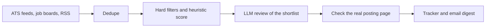

# opportunity-hunter-bot

Scheduled job and scholarship hunters. This repo contains code only. Every
profile, config, tracker and log lives in a separate private data repo that the
workflows check out at run time with a repo-scoped deploy key.

- `jobhunt/`: every 2 days. Job boards, ATS feeds and opportunity RSS, scored by a free LLM, emailed as a ranked digest.
- `scholarhunt/`: weekly. Scholarship RSS, public Telegram channels (read through their web preview, no login), watched lab pages, programme deadline alerts and, optionally, a Notion workspace (read rows, check official pages, write back).

## How it works



- **Sources:** fetchers for Greenhouse, Lever, Ashby, Workable and SmartRecruiters, plus job boards and RSS.
- **Cheap first, model second:** deterministic filters narrow the postings before any LLM quota is spent.
- **Provider fallback:** Gemini, then Groq, then OpenRouter. Rate-limited keys are rested and used-up keys are retired for the run. With no key left, jobs keep their keyword score.
- **Evidence required:** a second pass opens the real posting page, and its answer about who may apply must quote that page.
- **Public code, private data:** workflows run here, results are committed to the private repo, and public logs show counts only.

## Tech stack

Python 3.13, requests, feedparser, PyYAML, JobSpy, GitHub Actions (scheduled), Gemini, Groq and OpenRouter APIs, Notion API.

## How to run

The code expects to sit in a folder that also holds your private config files, as the workflows set up at run time.

```bash
git clone https://github.com/blip-cmd/opportunity-hunter-bot.git
pip install --require-hashes --no-deps -r opportunity-hunter-bot/requirements.lock

# copy jobhunt/ and scholarhunt/ into your data folder, then from that folder:
python -m jobhunt.run --dry-run --no-llm
python -m scholarhunt.run --dry-run --no-llm
```

`--dry-run` sends no email and writes no tracker or state. `--no-llm` skips the model calls.

## What I would improve next

- Add unit tests for the filters, the deduplication and the LLM key rotation.
- Add a CI job that runs those tests on pull requests without secrets.
- Publish an example config so others can try it without the private repo.

## Secrets (Settings → Secrets and variables → Actions)

| Secret | What |
|---|---|
| `PRIVATE_REPO` | `owner/name` of the private data repo |
| `DATA_REPO_KEY` | Private half of an SSH deploy key with write access, added to the data repo only. No expiry. |
| `GMAIL_ADDRESS` | Sender Gmail (a dedicated account) |
| `GMAIL_APP_PASSWORD` | 16-character app password for it |
| `GEMINI_API_KEY`, `GROQ_API_KEY`, `OPENROUTER_API_KEY` | Free LLM keys, at least one. Each may hold several comma-separated keys, used in turn so a rate limit or used-up quota on one key does not stall the run. |
| `NOTION_TOKEN` | Optional. Internal Notion integration token. Scholar Hunt reads the databases named in the private config and, when that config sets `write: true`, fills only its own "Bot:" columns, empty deadline fields and an activity log page. It never deletes anything. |

## Rules for this public repo

- Never add `pull_request_target` or any trigger that runs untrusted code with secrets.
- Never print hunt output in a workflow. Full logs go to `search/logs/` in the private repo.
- Change dependencies only by regenerating `requirements.lock` with `pip-compile --generate-hashes` (Python 3.13).
- Actions are pinned by commit SHA. Update the SHA and the version comment together.
